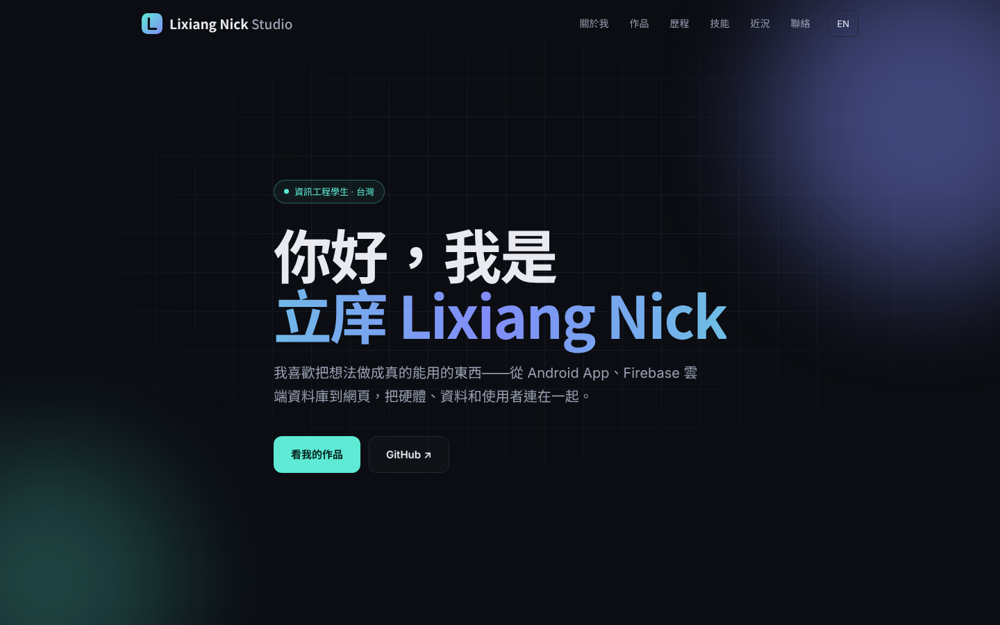
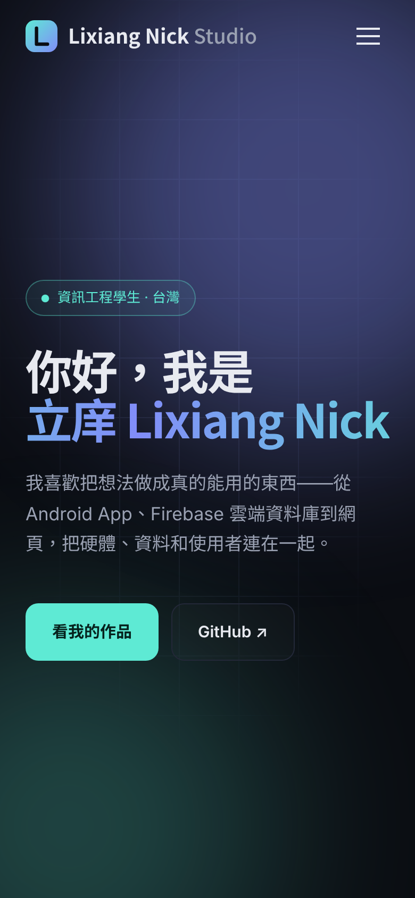

<div align="center">


# Lixiang Nick Studio

**立庠的個人網站 · Personal website of Lixiang Nick**

[](https://classy-beignet-781d38.netlify.app)

[](https://classy-beignet-781d38.netlify.app)


[中文](#中文) · [English](#english)



</div>

---

## 中文

這是我的個人網站，介紹我自己、我做過的作品、技能和近況。整個網站從設計到部署都是我一手完成，不用任何框架，一個 HTML 檔就能跑。

### ✨ 特色

| | |
|---|---|
| 🌏 **中英雙語** | 一鍵切換，英文系統的訪客會自動看到英文版 |
| 📱 **手機優先** | 手機、平板、電腦都好看，手機有專屬選單 |
| ⚡ **滿分效能** | Lighthouse 效能、無障礙、最佳做法、SEO 四項皆 100 分 |
| ♿ **無障礙** | 通過 axe 檢查、支援鍵盤操作、尊重「減少動態效果」設定 |
| ✉️ **聯絡表單** | 使用 Netlify Forms，不需要後端，內建防垃圾訊息 |
| 🚀 **自動部署** | push 到 `main`，Netlify 約 30 秒內自動上線 |

### 🗂 檔案結構

```
.
├── index.html          # 首頁（所有樣式與程式都在裡面）
├── brand.html          # 品牌資源：Logo、色彩、字體、語氣
├── privacy.html        # 隱私權政策
├── thanks.html         # 表單送出成功頁（無 JavaScript 時使用）
├── 404.html            # 找不到頁面
├── favicon.svg         # Logo 標誌
├── logo-wordmark.svg   # 完整 Logo
├── og.png              # 社群分享預覽圖
├── apple-touch-icon.png
├── robots.txt / sitemap.xml
├── netlify.toml        # 部署與安全標頭設定
└── docs/               # README 用的截圖
```

### 🛠 本機預覽

```bash
git clone https://github.com/Black-tea666888/nick-lixiang.git
cd nick-lixiang
python3 -m http.server 8000
# 打開 http://localhost:8000
```

### 🎨 品牌

| 名稱 | 色碼 | 用途 |
|---|---|---|
| Ink | `#0B0D12` | 背景 |
| Mint | `#5EEAD4` | 主色 |
| Indigo | `#818CF8` | 輔色 |
| Paper | `#E8EAF0` | 文字 |

字體：Space Grotesk（標題）、Inter（內文）、Noto Sans TC（中文）。完整規範見網站上的 [品牌資源](https://classy-beignet-781d38.netlify.app/brand.html)。

### 📬 聯絡

- Email：lixiangsu6@gmail.com
- GitHub：[@Black-tea666888](https://github.com/Black-tea666888)

---

## English

My personal website — who I am, what I've built, my skills and what I'm working on now. Designed and deployed entirely by me with plain HTML, CSS and JavaScript: no framework, no build step.

### ✨ Highlights

- 🌏 **Bilingual** — Chinese / English toggle, auto-detects the visitor's language
- 📱 **Mobile-first** — responsive layout with a dedicated mobile menu
- ⚡ **Perfect scores** — Lighthouse 100 in Performance, Accessibility, Best Practices and SEO
- ♿ **Accessible** — passes axe, keyboard-friendly, respects `prefers-reduced-motion`
- ✉️ **Contact form** — Netlify Forms with a honeypot, no backend needed
- 🚀 **Continuous deployment** — every push to `main` goes live on Netlify in ~30 seconds

### 🛠 Run locally

```bash
git clone https://github.com/Black-tea666888/nick-lixiang.git
cd nick-lixiang
python3 -m http.server 8000
```

Then open <http://localhost:8000>.

### 📱 Mobile



### 📄 License

The **code** is released under the [MIT License](LICENSE). The **content** — text, logo, brand assets and project descriptions — © Lixiang Nick, all rights reserved.

<div align="center"><sub>Built with ☕ by Lixiang Nick · 立庠</sub></div>
