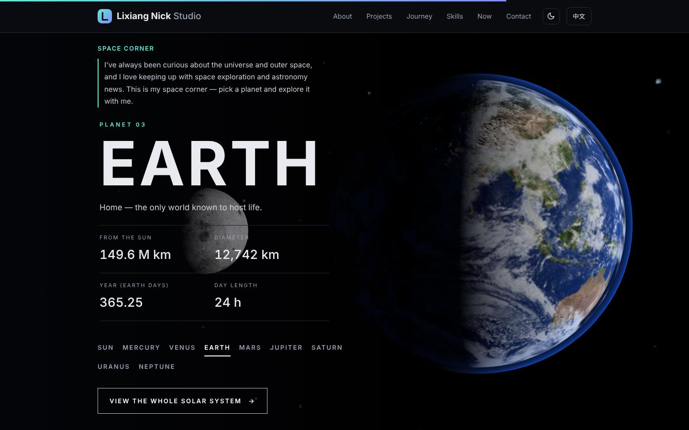
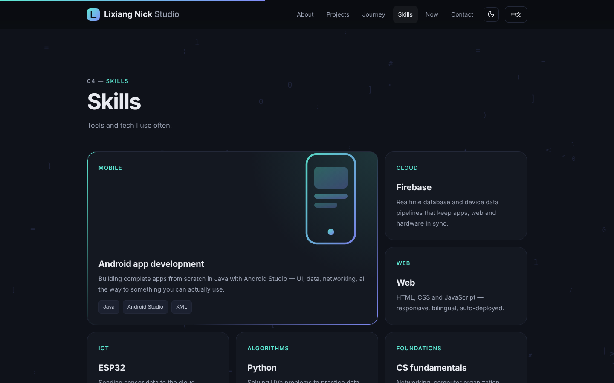

<div align="center">


# Lixiang Nick Studio

**Personal website of Lixiang Nick**

[](https://black-tea666888.github.io/nick-lixiang/)

[](https://black-tea666888.github.io/nick-lixiang/)


</div>

---

## About

My personal website — who I am, what I've built, my skills and what I'm working on now. Designed and deployed entirely by me with plain HTML, CSS and JavaScript: no framework, no build step.

### ✨ Highlights

- 🌏 **Bilingual** — Chinese / English toggle, auto-detects the visitor's language
- 📱 **Mobile-first** — responsive layout with a dedicated mobile menu
- ⚡ **Perfect scores** — Lighthouse 100 in Performance, Accessibility, Best Practices and SEO
- ♿ **Accessible** — passes axe, keyboard-friendly, respects `prefers-reduced-motion`
- ✉️ **Contact form** — Web3Forms on GitHub Pages (Netlify Forms on Netlify), with a honeypot
- 🪐 **3D solar system** — real planet textures, tap a planet to fly to it
- ✨ **Interactive backgrounds** — every section reacts to the cursor
- 🤖 **Ask Lixiang** — AI chat about Lixiang, powered by Gemini's free tier through a Cloudflare Worker (key stays server-side)
- 🌗 **Light / dark mode**
- 🚀 **Continuous deployment** — every push to `main` goes live on GitHub Pages in about a minute

### 🗂 Structure

```
.
├── index.html          # Home page (all styles and scripts inline)
├── brand.html          # Brand kit: logo, colors, type, voice
├── privacy.html        # Privacy policy
├── thanks.html         # Form success page (no-JS fallback)
├── 404.html            # Not found page
├── favicon.svg         # Logo mark
├── logo-wordmark.svg   # Full logo
├── og.png              # Social share image
├── robots.txt / sitemap.xml
├── space3d.js         # Interactive 3D solar system (three.js)
├── tex/               # Planet textures (Solar System Scope, CC BY 4.0)
├── media/             # Violin and swimming videos
├── vendor/            # three.js (MIT)
├── worker/             # Cloudflare Worker "nick-ask" — Gemini proxy for Ask Lixiang
├── netlify/functions/  # Same proxy as a Netlify Function (legacy host)
├── netlify.toml        # Netlify config (legacy host)
└── docs/               # README screenshots
```

### 🎨 Brand

| Name | Hex | Use |
|---|---|---|
| Ink | `#0B0D12` | Background |
| Mint | `#5EEAD4` | Primary |
| Indigo | `#818CF8` | Secondary |
| Paper | `#E8EAF0` | Text |

Fonts: Space Grotesk (headings), Inter (body), Noto Sans TC (Chinese). Full guide: [Brand kit](https://black-tea666888.github.io/nick-lixiang/brand.html).

### 📚 Docs

- [Development notes](docs/DEVELOPMENT.md) — architecture, deployment, AI chat, forms, performance work
- [Changelog](CHANGELOG.md)

### 🛠 Run locally

```bash
git clone https://github.com/Black-tea666888/nick-lixiang.git
cd nick-lixiang
python3 -m http.server 8000
```

Then open <http://localhost:8000>.

### 🪐 Interactive 3D solar system



### 🧩 Skills



### 📱 Mobile


### 📬 Contact

- Email: lixiangsu6@gmail.com
- GitHub: [@Black-tea666888](https://github.com/Black-tea666888)

### 📄 License

The **code** is released under the [MIT License](LICENSE). Planet textures: [Solar System Scope](https://www.solarsystemscope.com/textures/) (CC BY 4.0). 3D rendering: [three.js](https://threejs.org) (MIT). The **content** — text, logo, brand assets and project descriptions — © Lixiang Nick, all rights reserved.

<div align="center"><sub>Built with ☕ by Lixiang Nick</sub></div>
